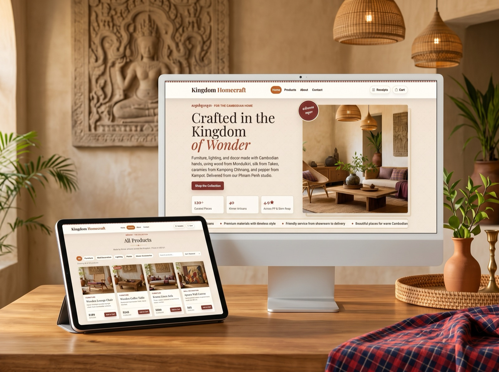
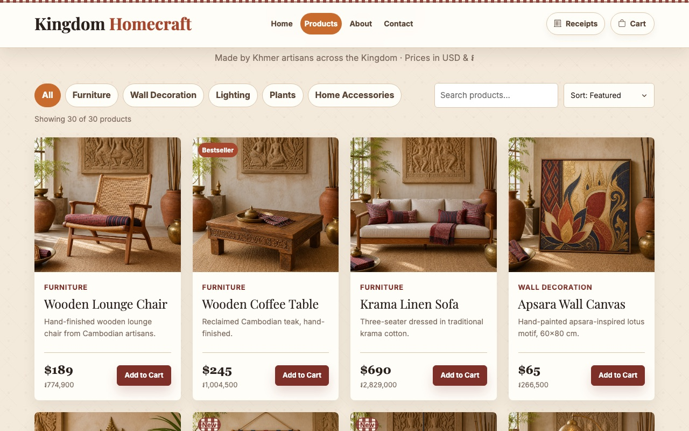
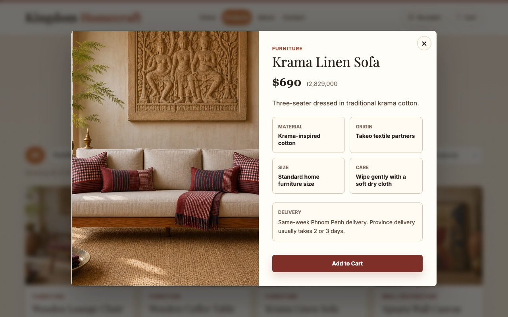
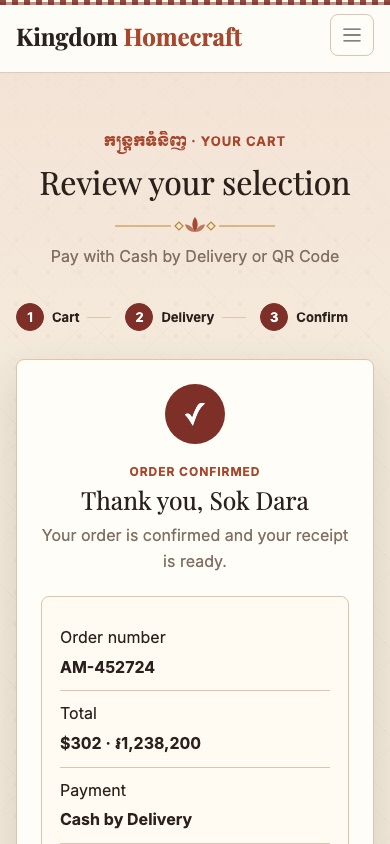
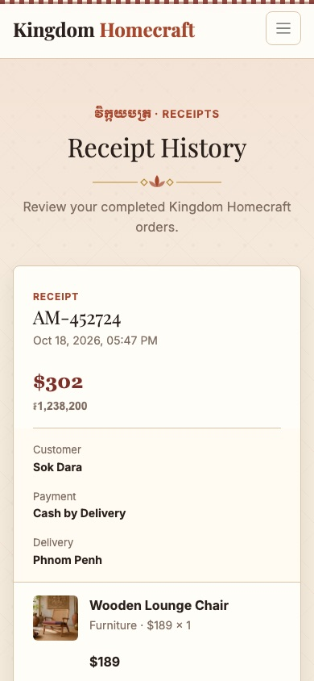

# Kingdom Homecraft

An online store for handmade Cambodian furniture and home decor. Prices are shown in US dollars and Khmer riel.

**Live site:** https://webdevassaignment.vercel.app



## About

Kingdom Homecraft is a web development assignment. It is a store for furniture, lighting, plants and decor made by Khmer artisans. It is built with HTML, CSS, Bootstrap and plain JavaScript. It has no backend: the cart and receipts are saved in the browser with `localStorage`.

## Features

- **Catalog:** 30 products in 5 categories (Furniture, Wall Decoration, Lighting, Plants, Home Accessories)
- **Find products:** category filters, live search, and sorting by price or name
- **Product details:** a popup with material, origin, size, care and delivery info
- **Cart:** change quantities or remove items. The cart count shows in the navbar on every page
- **Checkout:** customer details, a searchable list of all 25 provinces, a delivery date, and cash on delivery or QR payment
- **Prices:** every price in USD and riel (1 USD = 4,100 KHR). Delivery is free on orders over $200, otherwise $5
- **Receipts:** each order is saved, and you can see past orders on the Receipts page
- **Design:** a Khmer-inspired theme with Khmer text, and a layout that works on phones

## Screenshots

| Product catalog | Product details |
| --- | --- |
|  |  |

| Order confirmed | Receipt history |
| --- | --- |
|  |  |

## Built with

- HTML5 and CSS3
- [Bootstrap 5.3](https://getbootstrap.com/) and Bootstrap Icons
- Plain JavaScript (no framework, no build step)
- `localStorage` for the cart and receipts
- Google Fonts: Playfair Display, Inter, Noto Serif Khmer, Moul
- Hosted on [Vercel](https://vercel.com/)

## Pages

| Page | What it does |
| --- | --- |
| `index.html` | Home page: hero, deals slideshow, categories, featured products, reviews and newsletter |
| `products.html` | Full catalog with filters, search and sorting |
| `cart.html` | Cart, checkout form and order confirmation |
| `receipts.html` | Past orders saved in the browser |
| `about.html` | The story behind the shop |
| `contact.html` | Contact form and shop details |

## Project structure

```
├── *.html            # one file per page
├── style.css         # imports the files in css/
├── css/              # styles split by area (base, navigation, components, checkout, theme, ...)
├── script.js         # runs every feature when the page loads
├── js/
│   ├── data-store.js            # cart and receipt storage, price formatting
│   ├── cart-badge.js            # cart count in the navbar, toast messages
│   ├── product-interactions.js  # add to cart, filters, search, sort, detail popup
│   ├── cart-page.js             # cart, checkout and order confirmation
│   ├── receipts.js              # receipt history page
│   ├── forms.js                 # contact and newsletter forms
│   └── home-ui.js               # header shadow, slideshow, reveal animations
├── product-photos/   # product images (see PHOTO_SOURCES.md)
└── site-photos/      # hero, about and payment images
```

## Run it locally

You don't need to install anything. Clone the repo and open `index.html` in a browser:

```bash
git clone https://github.com/Tisaa-no-smoke/Web_Assignment.git
cd Web_Assignment
open index.html
```

Or serve the folder with any static server, for example `npx serve .` or VS Code Live Server.

## Notes

- This is a demo store. No real payments are taken and orders are not sent anywhere.
- The cart and receipts are saved only in your browser. Clearing site data removes them.
- Product photos are AI-generated mockups made for this project. See [`product-photos/PHOTO_SOURCES.md`](product-photos/PHOTO_SOURCES.md).

## Author

**Sao Kuntisa** · Software Development student, Norton University

- GitHub: [@Tisaa-no-smoke](https://github.com/Tisaa-no-smoke)
- Telegram: [@kuntisa12](https://t.me/kuntisa12)
